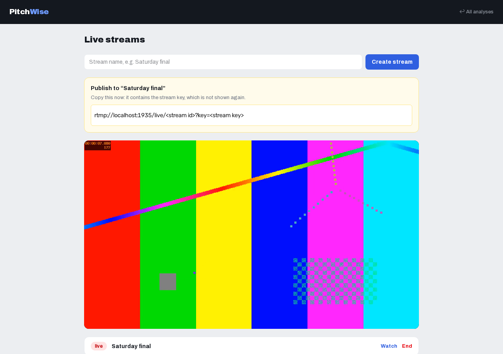

# PitchWise Platform

[](https://github.com/arturbuszka/PitchWise.Platform/actions/workflows/ci.yml)

A club in a lower league has cameras, but no way to broadcast from them. PitchWise is the service
behind that broadcast: the club creates a match, points its encoder at the address it gets, and shares
a public page, or embeds the player on its own site.



Built with ASP.NET Core 10, EF Core, PostgreSQL, Redis, MediaMTX, nginx and Next.js.

## What it does

- **Matches:** a match has one or more inputs, usually one per camera. Each gets its own address and
  key for the encoder, over SRT or RTMP. One input is on air.
- **Signal status:** for each input, whether data is arriving, the bitrate and, over SRT, packet loss
  and round trip time.
- **Public page and embed:** viewers need no account. A dropped encoder shows a message and picks up
  again on reconnect.
- **Secure delivery:** viewers get signed, expiring URLs. An nginx edge checks them and caches the
  video, so the API never carries video bytes.
- **Analyses:** every match has one for marking moments and rendering a highlight reel with ffmpeg,
  and it accepts uploaded recordings. A live broadcast isn't recorded into it yet.
- **Multi-tenant:** each customer has an API key and can only reach their own data.
- **Share links:** public, time-limited links to a highlight.

Not built yet: recording, sending to YouTube and Twitch, cutting between cameras without a reload, and
live statistics. See the [roadmap](#roadmap).

## Architecture

```
                         control (JSON)
  Customer / web console ───────────────► API ◄──────► PostgreSQL
                                           │  ▲
                              render jobs  │  │ who may publish? who is publishing?
                                           ▼  │
                               Redis ──► Worker (ffmpeg)   MediaMTX ◄── SRT / RTMP ── Encoders
                                           │                  │
                                           ▼                  ▼ HLS
                                        Storage ──────► nginx edge ──► Viewers
                                                     signature check + cache
```

Decisions worth explaining:

- **The video path and the control path are separate.** Video goes from encoder to edge without
  touching the API, so a slow API does not stall a broadcast. Viewers do ask the API about the match:
  every 30 seconds while watching and 10 while waiting, so that cost grows with the audience.
- **The signature is in the URL path of live streams.** Relative playlist and segment URLs inherit
  it, so nothing is rewritten on the way. The cache key leaves it out, so all viewers share one
  entry per segment, and playlists are cached for a second.
- **Reading is only allowed over HLS.** MediaMTX's RTMP and SRT ports are open to the internet for
  encoders, and reading a stream through them would skip the edge and its signature check.
- **Match status is polled from MediaMTX.** A missed callback or a crash on either side can't leave
  a match showing "live" forever. A dropped encoder puts the match back to `waiting` and can
  reconnect; only the customer can end a match for good.
- **Signal readings live in memory, not in the database.** They change every two seconds and mean
  nothing after a restart. Each API instance polls for itself, so instances share nothing. A connected
  encoder that stopped sending still looks ready to MediaMTX, so "stalled" is worked out from whether
  its byte counter is moving.
- **A match always has an analysis.** That is where a recording will land, so a highlight from a live
  match will work the same way as one from an upload.
- **The start of a match is when its signal first arrived**, as reported by MediaMTX. It is kept across
  reconnects, as the shared time zero for video and events.
- **Tenant checks live in one filter.** Every route under an analysis names `{analysisId}`, so a
  global filter covers them all. Other tenants get a 404, so ids can't be probed.
- **API keys and stream keys are stored hashed**, and shown only once.

## Run it

Needs Docker and Docker Compose. No GPU or model files.

```bash
docker compose up -d --build
```

| What | Where |
|---|---|
| Web console | http://localhost:3000 |
| API | http://localhost:8000 |
| HLS edge | http://localhost:8080 |
| RTMP ingest | rtmp://localhost:1935 |
| SRT ingest | srt://localhost:8890 (UDP) |

If port 8080 is taken, set another one for the edge: `EDGE_PORT=8081 docker compose up -d --build`.

### Broadcast a match

Open http://localhost:3000 and create a match, or use the API. The demo tenant's key is set up by
`docker-compose.yml`.

```bash
curl -s -X POST localhost:8000/api/matches \
  -H 'X-Api-Key: demo-key' -H 'Content-Type: application/json' -d '{"name":"Saturday final"}'
```

The response has what you need under `access`, and the stream key isn't shown again. Publish a test
signal to `srt_url` (this needs an ffmpeg built with SRT):

```bash
ffmpeg -re -f lavfi -i testsrc2=size=1280x720:rate=25 -f lavfi -i sine=frequency=440 \
  -c:v libx264 -preset veryfast -g 50 -pix_fmt yuv420p -c:a aac -f mpegts '<srt_url>'
```

Or to `rtmp_url`, with the same command ending in `-f flv '<rtmp_url>'`.

Then open `public_url` from the response to watch, as a viewer would. The page at `/matches/{id}` in the
console shows the state of the signal. To put the player on another site, use `embed_html`.

Use an encoder keyframe interval of about 2 seconds, as with `-g 50` here. Segments can't be shorter
than the distance between keyframes, and longer segments add delay for viewers.

### Add a customer

Set `ADMIN_TOKEN` (see [.env.example](.env.example)) and then:

```bash
curl -s -X POST localhost:8000/api/admin/tenants \
  -H "X-Admin-Token: $ADMIN_TOKEN" -H 'Content-Type: application/json' -d '{"name":"Acme FC"}'
```

## API

Send `X-Api-Key` on everything except health checks, public match data, share links and admin calls.

| Endpoint | Purpose |
|---|---|
| `POST /api/matches` | Create a match with one input; returns its encoder addresses and key once |
| `GET /api/matches`, `GET /api/matches/{id}` | List matches and read their status, inputs and signal |
| `POST /api/matches/{id}/inputs` | Add an input; returns its addresses and key once |
| `POST /api/matches/{id}/inputs/{inputId}/rotate-key` | Replace a lost or leaked key, disconnecting the encoder |
| `PUT /api/matches/{id}/program` | Choose which input is on air |
| `GET /api/matches/{id}/playback` | Signed HLS URL of what is on air (`409` unless live) |
| `POST /api/matches/{id}/end` | Disconnect the encoders and close the match |
| `GET /api/public/matches/{publicId}` | What the public page reads; needs no key |
| `POST /api/analyses` | Create a match |
| `POST /api/analyses/{id}/videos` | Upload a recording |
| `POST /api/analyses/{id}/events` | Mark a moment |
| `POST /api/analyses/{id}/highlights` | Render a reel from selected moments |
| `GET /api/analyses/{id}/highlights/{hid}/hls` | Signed HLS URL for the reel |
| `POST /api/analyses/{id}/highlights/{hid}/share` | Create a public link |

## Develop

Run the backing services in Docker and the code on your machine, so you can set breakpoints. Needs
the .NET 10 SDK, Node 22, ffmpeg and Docker. Stop the full stack first with `docker compose down`,
as both use the same ports.

**Infrastructure:** Postgres, Redis, MediaMTX and the nginx edge.

```bash
docker compose -f docker-compose.infra.yml up -d --wait
```

**API**, in its own terminal. It applies migrations on startup and creates the tenant for `demo-key`.

```bash
dotnet run --project api-dotnet
```

**Worker**, in its own terminal. It renders highlight reels with the local ffmpeg.

```bash
dotnet run --project worker-dotnet/PitchWise.Worker
```

**Web console**, in its own terminal, at http://localhost:3000. `WEB_API_KEY` is the key that the
console adds to its calls to the API. Without it, every call gets a `401`.

```bash
cd web
npm ci
WEB_API_KEY=demo-key npm run dev
```

The [broadcast steps](#broadcast-a-match) above work the same way against this setup. Files go to
`.dev-storage/`, not `storage/`, because the full stack creates `storage/` as root.

**Debugging in VS Code:** with the C# extension, open the Run and Debug view and start **API**, then
**Worker** and **Web console**. **API** brings the infrastructure up and builds first. The tasks
`infra: up`, `infra: down`, `build` and `test` are in `.vscode/tasks.json`.

Good to know:

- MediaMTX runs in a container and calls the API to check stream keys, so the API listens on
  `0.0.0.0:8000`. On a machine your network can reach, anyone there can reach this API too.
- If streams are refused with the API running, a firewall may be blocking containers from reaching
  the host on port 8000.
- If port 8080 is taken, start the infrastructure with `EDGE_PORT=8081` and the API with
  `HLS_BASE_URL=http://localhost:8081`.
- `docker compose -f docker-compose.infra.yml down -v` also deletes the development database.

### Tests

```bash
dotnet test PitchWise.slnx
```

Integration tests run the real API and migrations against Postgres and Redis containers from
Testcontainers, so they need Docker, but not the infrastructure above. MediaMTX is faked in these
tests. CI also builds every image.

To change the schema:

```bash
dotnet tool restore
dotnet ef migrations add <Name> --project shared/PitchWise.Data
```

## Roadmap

1. **Recording:** a broadcast records itself and is available as a video afterwards, in the match's
   analysis, so highlights work on live matches.
2. **YouTube and Twitch:** a copy of the signal for each destination, each failing on its own.
3. **A switcher:** an operator cuts between cameras in the console, and viewers, the recording and
   every destination get one program.
4. **Analysis after the match:** a worker runs [PitchWise.Lab](https://github.com/arturbuszka/PitchWise.Lab),
   a .NET computer vision pipeline, on a recording and stores the results. Lab is a separate process
   that receives a copy of the video and returns only data, so its failure can't stop a broadcast.
5. **Live analysis:** turn Lab's batch modules into streaming ones. Measured on a GTX 1660 Ti, the full
   pipeline takes about 0.87 s per frame, but detection, re-identification and tracking only about
   0.15 s. Most of the rest is pitch calibration, which needn't run on every frame.

## Known limitations

- **Jobs can be lost.** A worker crash loses the job it popped from Redis, and a crash between the
  database write and the push leaves a job that never starts. A reliable queue and an outbox would
  close both gaps.
- **Shared disk.** The API, worker and edge exchange files through one volume, so they can't run on
  separate machines without object storage.
- **One quality level.** MediaMTX repackages what the encoder sends, so there is no adaptive bitrate
  yet. That would be a transcoding step.
- **API keys can't be rotated or revoked** through the API yet. Stream keys can be replaced.
- **Inputs can't be removed** from a match once added.
- **Keys travel unencrypted.** Encoders send the stream key in the clear over both RTMP and SRT, as
  there's no RTMPS or SRT passphrase set up. Use a VPN on an untrusted network.
- **Changing the input on air reloads the player.** Viewers move over within about 30 seconds, with
  a break in the picture. Each camera also needs its own connection and its own bitrate.
- **Packet loss is only known over SRT.** RTMP runs over TCP, which hides it.
- **The web console acts as one tenant.** It adds the demo key on the server, so it needs a login
  before being exposed.
- **MD5 signatures.** nginx `secure_link` requires MD5. A commercial CDN's token auth would replace it.
- **Broadcasts aren't recorded yet.** A broadcast is gone once it leaves the playlist, so the analysis
  of a live match has no video unless one is uploaded.
- **A match page has nothing to show afterwards.** Once a match ends, viewers just see that it has.

## License

[MIT](LICENSE)
